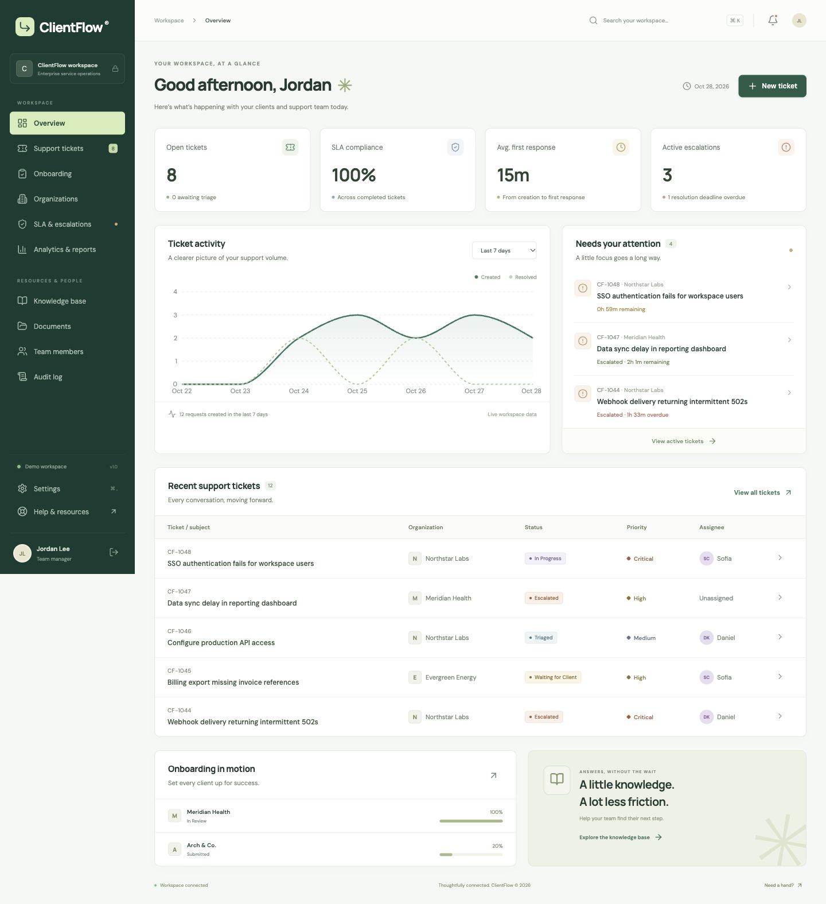

# ClientFlow

A working enterprise service workspace for client onboarding and technical support. Built with **React, TypeScript, Spring Boot, Spring Security, JDBC, Flyway**, and a relational database. The default demo uses a persistent embedded database so it starts without Docker; an optional MySQL Compose configuration is included.



## Start the demo

**On this Mac:** double-click `start.command`, or run:

```bash
./scripts/start
```

Open **http://127.0.0.1:8080**. The app opens your browser automatically on macOS. Choose a role on the login screen and select **Enter workspace**. Stop the server with **Ctrl+C** in its terminal.

The built application is already in `backend/target/clientflow-1.0.0.jar`. After source changes, rebuild with `./scripts/build`, then restart. The first build needs internet access, Node 22.12+ and Java 21+. Maven downloads automatically into `.tools/`; no global Maven installation is needed. Fonts and icons are bundled, so the built demo has no CDN dependency.

## Demo accounts

All sample accounts use **`DemoFlow!2026`**. They contain fictional data only.

| Perspective | Email | Main capabilities |
|---|---|---|
| Team manager | manager@clientflow.demo | Assign requests, review onboarding, edit SLA targets, publish articles, export reports |
| Support engineer | engineer@clientflow.demo | Triage, investigate, add internal notes, reply, resolve |
| Client · Northstar | client@northstar.demo | Create requests, view own organization, upload documents, confirm/reopen resolutions |
| Administrator | admin@clientflow.demo | Manager capabilities plus staff role administration |
| Client · Meridian | client@meridian.demo | A second tenant for demonstrating access isolation |

Use **Sign out** at the bottom of the navigation to switch roles. [Demo walkthrough](docs/DEMO.md).

## Working features

- Role-specific navigation and server-enforced organization authorization.
- Session authentication with BCrypt passwords, CSRF protection, HTTP-only cookies, login throttling, and session expiration handling.
- Ticket creation, searching, status/priority/organization filters, pagination, assignment, validated state transitions, and required resolution summaries.
- Public conversations, private employee notes, secure ticket attachments, and chronological ticket activity.
- Five-step organization onboarding, progress tracking, submission, review, information requests, rejection reasons, approval, and activation.
- Configurable first-response and resolution targets. A scheduled engine checks every minute and escalates each request once per active cycle.
- Persisted in-app notifications, read/unread controls, preferences, and 15-second workspace refreshes.
- Live dashboard metrics, ticket trends, team workload, organization analytics, and safe CSV exports.
- Knowledge article search, categories, publishing, editing, archiving, and republishing.
- Private document uploads/downloads, organization administration, staff role controls, and append-only application audit logs.
- Desktop and mobile layouts, accessible form labels, keyboard navigation, dialog focus trapping, and clear empty/error states.
- Persistent demo data, API documentation, database migrations, tests, a container build, and a CI workflow.

## Build and verify

```bash
./scripts/build                       # locked frontend install, TypeScript, Vite, Java integration tests, executable jar
./scripts/mvn -f backend/pom.xml test  # backend tests only
cd frontend
npm run typecheck
npm run format:check
```

With the packaged app running in another terminal:

```bash
./scripts/test-e2e
```

The Playwright suite uses a real browser to test the main role journey, navigation, filters, onboarding, article publication, file handling, and responsive layout. Run against a fresh demo database for repeatability; it intentionally creates sample records. See [verification notes](docs/VERIFICATION.md) for what was executed in this environment.

## Development

```bash
# Terminal 1, from repository root
./scripts/mvn -f backend/pom.xml spring-boot:run
# Terminal 2
cd frontend
npm ci
npm run dev
```

The development frontend uses `http://127.0.0.1:5173` and proxies API requests to port 8080. The packaged jar serves both frontend and API on port 8080. Hash-based navigation supports refresh and direct ticket links without extra hosting rules.

## Optional Docker + MySQL

Docker is optional and was unavailable in the build environment. The configuration is provided for a local MySQL demonstration:

```bash
cp .env.example .env
# Set distinct DB_PASSWORD and DB_ROOT_PASSWORD values in .env.
docker compose up --build
```

Stop any locally running ClientFlow instance first. Compose binds the web port to loopback, keeps MySQL off the host network, waits for database health, persists documents and database data, and runs the app as a non-root user. Demo accounts remain enabled. This is a local demonstration configuration.

## Data, reset, and troubleshooting

The local jar stores data under `backend/data/`. It survives restarts. Uploaded files are stored outside static web assets and accessed through authorization-checked endpoints.

For a fresh presentation dataset, stop the server and run:

```bash
./scripts/reset-demo --confirm
./scripts/start
```

Reset **archives** the current local data to `.tools/backups/` before reseeding. It does not delete the previous dataset. It does not reset MySQL volumes.

If port 8080 is in use by something else, use `PORT=8081 ./scripts/start`. If the app cannot connect, check the startup terminal; the interface will show a reconnecting banner. Session cookies are scoped to the host, so use `127.0.0.1` consistently when switching between development and packaged runs.

## API and architecture

- [Interactive OpenAPI](http://127.0.0.1:8080/swagger-ui/index.html), including the session/CSRF endpoints.
- [OpenAPI JSON](http://127.0.0.1:8080/v3/api-docs).
- [Health](http://127.0.0.1:8080/actuator/health).
- [Architecture and data model](docs/ARCHITECTURE.md).
- [Implementation decisions](docs/ADR-001.md).
- [Demo scope and remaining production integrations](docs/SCOPE.md).

The delivered app is a **local full-stack demo implemented as a modular monolith**. The broader brief’s independently deployed microservices, Keycloak/OIDC, RabbitMQ/email delivery, external object storage, and hosted deployment are documented next steps; they are not represented as connected services in this demo.
