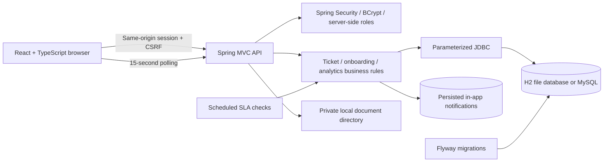
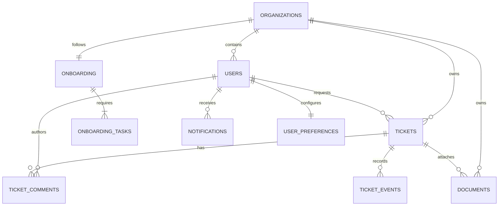

# Architecture and data model

## Running system

The executable jar includes the frontend build. Default network exposure is loopback only. The app is intentionally a single deployable process for this local demo. All staff demo users belong to one shared support operation; clients have one organization each. Independently configured support-team partitions are outside the demo scope.

## Relational model

Additional independent tables: `sla_policies`, `knowledge_articles`, and `audit_events`. Flyway files under `backend/src/main/resources/db/migration` are the schema source of truth. Foreign keys enforce ownership links; indexes cover organization/status queries, deadlines, and notification retrieval.

## Authorization

`WorkspaceService.user` resolves the authenticated principal from the database on each request. Client organization access is validated before reading or mutating tickets, onboarding, comments, or documents. Out-of-tenant resources return 404. Client collection responses exclude staff profiles, other organizations, audit logs, and internal notes. Staff-only and manager/admin-only checks run on the server, independently of navigation visibility.

Authentication uses a server-side session and an HTTP-only SameSite=Strict cookie. Writes require a CSRF token retrieved from `/api/v1/auth/csrf`. Login rotates the existing session identifier and uses BCrypt credential checks. Logout invalidates the session. Demo login attempts are throttled per source address.

## Workflows

Ticket transitions are defined in one server-side transition map. Resolution requires a summary. Clients may confirm a resolved ticket or reopen a completed ticket, and may never create internal notes. Reopening clears `resolved_at`, resets the resolution deadline using the current policy, and permits a new escalation cycle.

Ticket creation and multi-step ticket/onboarding actions are transactional. Reference generation is serialized within the demo process; a distributed deployment should replace this with a database sequence/counter or an idempotency-key-backed identifier strategy.

Onboarding submissions require every checklist task to be complete. Checklists are locked during review and after approval, activation, or rejection. Managers may request information or record a rejection reason. Information requests unlock the checklist for another submission.

## SLA and metrics

Deadlines use UTC instants and elapsed time. The engine checks unresolved tickets every minute. Missing a first-response target or resolution target changes the request to Escalated once; conditional database updates prevent duplicate scheduler events. Policies affect new tickets and future priority changes, preserving existing deadlines otherwise.

Open tickets include all states except Resolved and Closed. Completed tickets are those in Resolved or Closed. Resolution SLA compliance is completed tickets with `resolved_at <= due_at`, divided by completed tickets. With no completed tickets, the display is 100%. Average first response includes only tickets with a recorded public staff reply. Creation charts count creation timestamps; resolution charts count resolution timestamps by the viewer’s local calendar day. Analytics are computed from database records; they are not hardcoded trend data.

## Storage and notifications

Files are stored under opaque UUID names outside static assets. Only metadata is in the relational database. File extensions and size are validated; downloads use attachment disposition and authorization checks. This demo does not perform malware scanning or connect to cloud object storage.

In-app notification records are written as part of transactional business operations. They are delivered through workspace polling. There is no simulated external email send or fake queue status. Preferences control notification center visibility and do not erase the underlying record.
